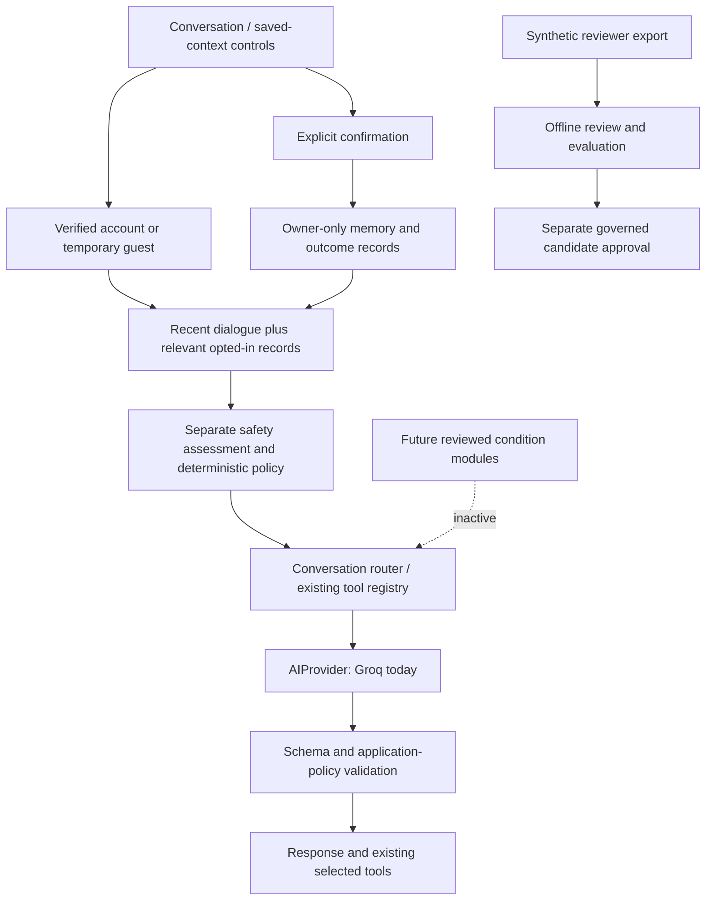

# Paasaa foundation implementation

October 25, 2026. Scope: evolve the existing self-help prototype; create the foundations for later reviewed clinical programs. Groq remains the only implemented language-model provider. No weights were trained. No new social-anxiety, OCD/ERP, exposure, diagnostic or condition-specific assessment protocol was added.

## Audit and preserved behavior

The frontend is plain JavaScript/CSS with hash navigation, chat, embedded reflections, check-ins, breathing and immediate support. Vercel serves static assets and a Node API adapter. Supabase verifies account JWTs and enforces owner-only row access. Google/email authentication and temporary guest sessions remain. Guest activity does not enter durable record storage. The local preview uses a synthetic SQLite owner.

Existing conversation planning, safety classification, deterministic routing, structured-output validation, confirmed worksheet answers, Groq transcription, Resend team-contact notifications, and the synthetic owner dashboard remain. Short-term engine memory already existed; user-approved durable context and outcomes did not. The research pilot already held synthetic drafts blocked from training. The clinical knowledge collection was and remains empty pending qualified approval.

Unsafe assumptions to avoid: a safety classification is not clinician review; sending a notification is not acknowledgment; a self-report is not a clinical finding; a model failure is not evidence of crisis; a public research result is not Paasaa efficacy. Existing conservative unwanted-thought/reassurance routing labels predate this phase and are not a new OCD program. Actual clinician assignments, staffing, delivery and acknowledgment services are not connected.

## Implemented phases

| Phase | Files/components | Database/API change | Verification and remaining boundary |
|---|---|---|---|
| 1 Audit | This report; existing adapters, stores and routes inspected | Existing schema and RLS inspected before migration | Preserve the current project and service boundaries |
| 2 Provider boundary | `server/ai-provider.js`, `ai-config.js`, `ai.js`, engine; `.env.example` | No schema change | `generate`, `generateStructured`, `classify`, `embed` contracts. Embedding explicitly unsupported. Only Groq implemented |
| 3 Durable memory | `patient-context.js`, `foundation-api.js`, `foundation-contracts.js`, `src/patient-memory.js` | GET/POST `/api/memory`; new record kind | Confirmation, owner binding, expiry, revisions, edit/revoke, opt-in filtering tested |
| 4 Outcomes | Same context API/UI; `engine-api.js` | GET/POST `/api/intervention-outcomes`; new record kind | Registry IDs, user-entered times, nullable ratings, helpfulness, notes and due follow-ups. No outcome inferred from silence |
| 5 Independent safety | `server/safety-service.js`, engine version metadata | No new clinical endpoint | Reuses separate classifier plus deterministic policy; outage and contextual-risk tests preserved. Not validated detection for every listed future risk area |
| 6 Review infrastructure | `review-workflow.js`, `src/review-draft.js`, dashboard | No live patient review endpoint | Synthetic exchange → rating/correction/rationale → downloadable draft → offline state transitions. No fake clinician identity or production monitoring |
| 7 Future modules | `condition-modules.js`, `intervention-registry.js` | None | Empty module registry; clinical metadata inactive until approval, eligibility, context and consent checks pass |
| 8 Corpus | `clinical-corpus.schema.json`, `corpus-pipeline.js` | Offline only | Rich context/history/state/rationale/contrast schema, strict role/content history; no bulk generation or external corpus ingestion |
| 9 Evaluation | `scripts/foundation-research.mjs`, synthetic fixtures | Offline only | 14 review dimensions, model/prompt/policy/language provenance, null means unrated. Candidate approval does not authorize training |
| 10 UI cleanup | `foundation.css`, `ui-icons.js`, app, chat tool registry | None | Line icons, quieter controls, sans-serif chat headings; existing reflection uses tool registry |
| 11 Landing | `landing.js`, `foundation.css` | None | Specific prototype copy, existing nature image, bounded decorative motion, reduced-motion override; no fake proof or supervision claims |
| 12 Trust pages | `trust-content.js`, `trust.css`, build scripts, Vercel rewrites | Public `/privacy`, `/terms`, `/safety`, `/about`, `/help` | Standalone unauthenticated pages; privacy and terms explicitly drafted for professional review |
| 13 Branding | `index.html`, footer, existing custom favicon | None | Paasaa branding and clear trust links; no added builder branding, fabricated endorsements or user counts |
| 14 Readiness | `config/launch-readiness.json`, `scripts/launch-readiness.mjs` | None | Reports **not launch-ready**. Owner explicitly chose Vercel for now; domain deferred, no purchase |

## Data flow and consent

The owner explicitly authorized the new Groq flow with **per-record user opt-in**. Each record defaults off. The server selects only owned, confirmed, patient-entered, non-expired, opted-in data: at most four short memories and one relevant outcome. Explicit opted-in intervention refusals constrain recommendations. They are applied transiently and not copied into persisted conversation memory. Turning sharing off prevents future retrieval; it cannot retract earlier provider processing or text already present in a conversation. Current safety and the person's current choices override personalization. There is no automatic care-plan inference or model-driven write.

Supported durable types: preferred name/language, communication preferences, confirmed goals, triggers, recurring worries, declined existing practices, and confirmed history. Outcomes and scheduled follow-ups are separate records. Clinician care plans are not writable by patients. Check-ins show a due follow-up only when its owned confirmed record exists; no email/push reminder is sent.

The context selector is a bounded lexical baseline, not a clinically validated memory system or vector search. It currently loads up to 200 recent records per kind; larger archives require pagination/indexed retrieval. New controls and trust pages need native-language review before multilingual clinical use. No passive sensing, engagement optimization or automatic training was added.

## Migration and API details

Applied Supabase migration `20261025044315_foundation_context_records.sql`. It expands `paasaa_records.kind` to include `memory` and `intervention_outcome`. It does not change existing rows, grants or policies. RLS remains enabled, with owner equality and anonymous-user exclusion on SELECT, INSERT and UPDATE. The local adapter now returns the authoritative record kind, fixing a regression caught by the existing worry tests. Legacy worry paths cannot modify memory records.

Memory POST accepts only type, content, explicit confirmation, use-in-chat, optional expiry, and revision/id when editing. Revoke clears active content and disables sharing. Outcome creation accepts an existing practice ID, context, actual start/end times, optional pre/post ratings, helpfulness, feedback, follow-up date and explicit confirmation/sharing. Outcome updates are limited to sharing and completion of the follow-up. Client-supplied ownership, clinical verification and unsupported fields are rejected. Conflicting edits return 409. Guests cannot call these durable endpoints.

Production Supabase post-migration inspection confirmed the expanded check constraint and unchanged policies. Advisors found no missing policy on the record table. Existing notices remain: private quota table has intentionally no direct policies; the owner-bound homepage email-interest table permits guest contact submissions; leaked-password protection is disabled. Review [Supabase password protection](https://supabase.com/docs/guides/auth/password-security#password-strength-and-leaked-password-protection) and [anonymous-access policy guidance](https://supabase.com/docs/guides/database/database-advisors?queryGroups=lint&lint=0012_auth_allow_anonymous_sign_ins) during launch preparation. No paid settings were changed.

## Verification

- Full automated suite: 293 passing tests, including owner isolation, guest denial, confirmation, expiry/revocation, per-record opt-out, nullable ratings, stale revision conflicts, cross-kind rejection, inactive clinical modules, notification/acknowledgment distinction and existing chat/safety/CBT behavior.
- `npm run check`, `npm run build` and `node scripts/build-vercel.mjs` passed. `git diff --check` passed.
- Browser → local API → SQLite → UI: created a clearly synthetic memory with sharing off, edited sharing on then off, and recorded a synthetic outcome with missing ratings preserved. Reloaded screens showed stored data. No real patient record was used.
- Public local privacy route rendered independently. Refined homepage and synthetic dashboard rendered. Review export contained the exact consented fictional exchange; the offline review command accepted the downloaded draft and recorded review transitions with reviewer identity explicitly unverified.
- Offline corpus fixture validates; evaluation fixture reports all 14 dimensions unrated; no score or clinical benefit fabricated. The readiness command reports remaining blockers. No new live-provider clinical-quality evaluation was performed in this foundation phase.
- Vercel release verification is recorded below after deployment. Local browser checks do not establish clinical safety, teen suitability, or all-device accessibility.

## Manual work before a clinical launch

Qualified clinical review and staffed operations; verified reviewer identities and patient assignments; actual delivery/acknowledgment services; lawful age/jurisdiction/consent handling; reviewed source licensing and corpus governance; language-specific and adolescent evaluations; retention, deletion/export and incident-response operations; provider contractual/data/age eligibility review; legal/privacy approval; and a custom domain when the owner is ready. The existing prototype can stay on Vercel without being described as a launched clinical service.

Provider credentials remain server-only and unchanged. Optional `PRIMARY_MODEL`, `FAST_MODEL`, `SAFETY_MODEL` override existing role defaults; `EMBEDDING_MODEL` is reserved and does not activate embeddings. The approved-knowledge store remains empty. Future provider adapters must implement the same contract and pass safety, output-policy, opt-out and regression evaluations before replacement.

Public research sources and limits are in `docs/evidence-register.md`. No Dartmouth affiliation, proprietary implementation, clinical review, efficacy or professional legal approval is implied.
